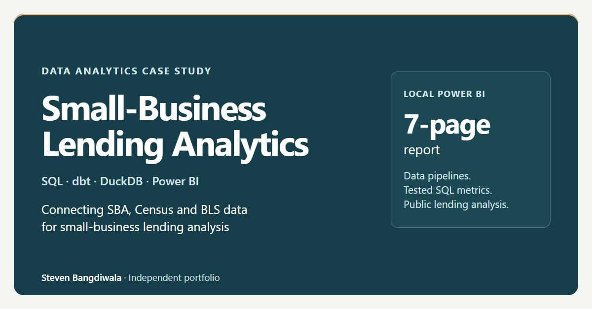
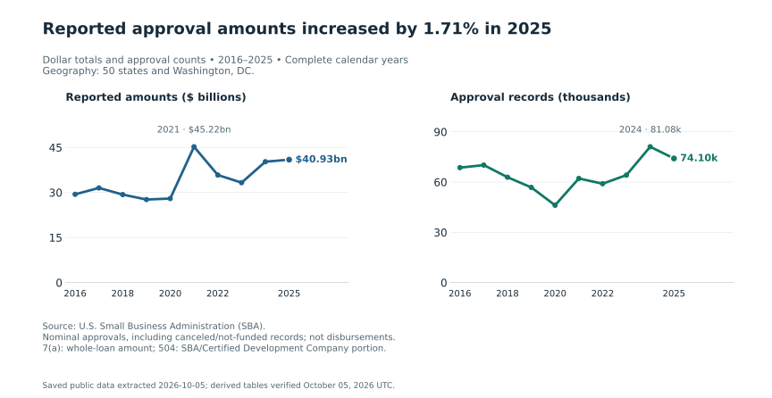
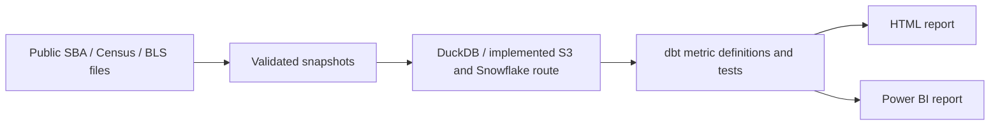

# Small-Business Lending Analytics

Where is SBA loan approval activity concentrated, and how does the answer change
when we compare it with the local business base? I built a Python and SQL pipeline
that turns public agency files into validated snapshots, tested metrics and a
readable analysis.

**[Read the report →](https://stevennitesh.github.io/small-business-lending-pipeline/)**

[](https://stevennitesh.github.io/small-business-lending-pipeline/)

Start with the findings, then follow six charts from annual change to geography,
programs, industries and lender names. Definitions, engineering decisions and
downloadable aggregate evidence are included. The report uses **2025 for lending**
and **2023 for the employer-location comparison**, from saved inputs checked on
**October 5, 2026 UTC**.

**Main finding:** reported 2025 amounts rose **1.71% to $40.93 billion**, while
approval records fell from **81,081 to 74,098**. Dollar totals and record volume
tell different stories.



The population covers 50 states and Washington, DC. These are nominal SBA
7(a)/504 approvals, including canceled/not-funded records, rather than
disbursements or unique borrowers. Combined amounts add whole 7(a) loans and the
SBA/Certified Development Company portion of 504 loans. The analysis describes
activity and context; it does not establish credit access or causal impact.

## What I built

- Source adapters, immutable snapshots, validation and checksums for public SBA,
  Census business-location and BLS labor data.
- Python/Prefect orchestration, local DuckDB processing and an implemented
  S3/Snowflake route.
- dbt definitions and tests for record eligibility, comparable periods and
  additive metric components, plus reporting exports.
- A seven-page Power BI report with filters, explicit DAX measures and a
  documented semantic model.
- Reproducible charts and an HTML report with exact aggregate values and provenance.

The agencies supply the data. DuckDB, dbt, Prefect and Power BI supply the
processing tools; I implemented their integration and the analysis contracts.



## Delivery status

- **Public:** browser findings, six responsive charts, exact aggregate downloads
  and [genuine captures of all seven Power BI pages](https://stevennitesh.github.io/small-business-lending-pipeline/#desktop-gallery).
- **Local:** the editable PBIX and Desktop-exported PDF stay out of Git. The
  report was saved and reopened on October 11, 2026 with 18 refreshed imports and
  24 passing DAX checks. [Desktop verification](powerbi/README.md#october-11-local-desktop-verification).
- **Data checks:** the October rebuild passed 328 real-data dbt tests; later
  readiness checked 18 CSVs / 253,942 rows and 25 relationships.
  [Recorded aggregate proof](docs/images/lending_verification.json).
- **Cloud:** the S3/Snowflake route is implemented; paid live execution is deferred.

Source evidence is frozen at its stated check time. Reading or rebuilding the
presentation does not refresh sources. The hosted site reflects its last published revision.

## Reproduce and inspect

Use Linux/WSL, Python 3.12 and Make, or Docker. The lightweight gate uses no live
source downloads or cloud credentials:

```bash
make install PYTHON=python3.12
make ci-check
make portfolio-report
```

The HTML builder uses versioned public aggregates and charts. You can also
download and open the [self-contained offline report](https://stevennitesh.github.io/small-business-lending-pipeline/offline.html). Exact
regeneration of the underlying charts needs matching saved CSVs and readiness
evidence, which are excluded from Git. A new live refresh may include publisher
revisions and change historical figures.

[Methodology](docs/detailed/kpi_definitions.md) ·
[Architecture](docs/detailed/architecture.md) ·
[Verification](docs/detailed/testing_plan.md) ·
[Runtime and reproduction](docs/detailed/orchestration_runtime.md) ·
[Documentation map](docs/README.md)

Steven Bangdiwala
